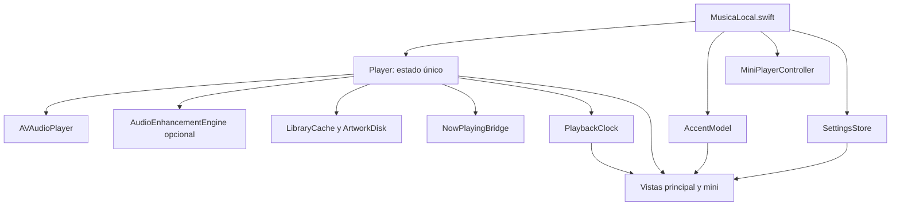

# AGENTS.md — Música Local

> **Instrucciones para asistentes de programación (Codex, Claude Code y agentes similares).**
> Aplican al repositorio completo desde su raíz. Léelas antes de editar archivos. Si hay instrucciones adicionales en carpetas específicas, aplícalas sin contradecir las restricciones fundamentales de compatibilidad y seguridad.

## 1. Misión y contexto

**Música Local 1.0.2** es un reproductor nativo de música local para macOS, gratuito, de código abierto y distribuido bajo **MIT**. Desarrollador: **Andrés Báez**. La interfaz actual está en **español**; en futuras versiones se prevé internacionalización.

Objetivos del proyecto:

- Reproducir una biblioteca musical local sin servicios de streaming.
- Mantener una interfaz de macOS ligera, consistente y utilizable en modo principal, mini compacto y mini ampliado.
- Ofrecer cola de reproducción, carátulas, acentos adaptados a ellas, visualizadores y audio experimental opcional.
- Preservar la estabilidad y el bajo consumo en hardware Intel antiguo, especialmente **MacBook Pro A1707 con Touch Bar**.
- Mantener un proyecto modular, compilable desde Terminal **sin `.xcodeproj`**.

**Regla esencial:** no sacrifiques funcionalidades existentes para implementar una modificación estética o aislada. Evita refactorizaciones no solicitadas. No cambies la versión pública, la identidad de la aplicación ni la licencia salvo instrucción explícita.

## 2. Fuente de verdad y lectura inicial

Antes de programar:

1. Lee este `AGENTS.md` y luego `README.md` y `STRUCTURE.md`.
2. Inspecciona **el código y los scripts realmente presentes**; no presupongas que el árbol es idéntico a una entrega anterior.
3. Localiza el punto de entrada y los modelos compartidos antes de editar una vista.
4. Si se solicita un cambio, identifica su alcance y los comportamientos que deben mantenerse intactos.
5. Comprueba `git status` antes y después: no sobreescribas cambios ajenos ni incluyas archivos generados o privados.

**Documentos:** `README.md` (uso, instalación y capacidades), `STRUCTURE.md` (mapa de módulos), `LICENSE.md`, `TERMINOS_Y_CONDICIONES.md` y `PRIVACIDAD.md`. Mantén la documentación sincronizada si cambias el funcionamiento documentado; no reescribas términos legales sin autorización.

## 3. Entorno y compatibilidad obligatoria

| Aspecto | Restricción |
|---|---|
| Sistema mínimo | **macOS 12.0 Monterey** |
| Hardware de referencia | **Intel x86_64**, MacBook Pro A1707 |
| Compilador de referencia | **Apple Swift 5.7.2** |
| UI y sistema | SwiftUI, AppKit, AVFoundation, MediaPlayer |
| Compilación | `build.sh` con `swiftc`, sin proyecto Xcode |
| Idioma actual | Español en interfaz, menús, ayuda y textos visibles |
| Distribución | Aplicación `.app` y DMG para GitHub Releases |

- No introduzcas APIs que requieran macOS 13+ sin alternativa efectiva para Monterey y comprobación `#available` cuando corresponda.
- Los problemas previos incluyeron `.fontWeight(...)` (disponibilidad macOS 13 en el contexto utilizado) y `NSApplication.AboutPanelOptionKey.copyright` (no admitida en el SDK del proyecto): usa alternativas compatibles.
- En SwiftUI de esta base, un `VStack`/`HStack` con muchos hijos directos ha causado errores `extra argument in call`. Divide vistas en subcomponentes o `Group` y valida su compilación.
- No confundas `swiftc -frontend -parse` con una compilación real: la verificación sintáctica sola **no valida disponibilidad de API ni tipos de AppKit**.
- El código puede prepararse desde otra plataforma, pero **la compilación y prueba nativas requieren macOS con el SDK correspondiente**. No afirmes que compila o que funciona en Touch Bar si no se ha probado allí.
- En el código y los scripts, usa rutas entrecomilladas: los directorios del desarrollador pueden contener espacios.

## 4. Arquitectura y responsabilidades

```text
MusicaLocal.swift                 Entrada @main, escenas, comandos y setup
src/
  Models/
    AccentModel.swift             Color predominante de la carátula
    ColumnLayout.swift            Disposición de columnas de biblioteca
    PlaybackModels.swift          PlaybackClock, RepeatMode y estado auxiliar
    Track.swift                   Modelo de pista
  Player/
    Player.swift                  Estado compartido; biblioteca, cola y reproducción
  Services/
    ArtworkDisk.swift             Caché persistente de carátulas
    ArtworkStore.swift            Solicitudes/decodificación en memoria
    AudioEnhancementEngine.swift  AVAudioEngine + AVAudioUnitEQ experimental
    FilenameParser.swift          Metadatos de nombres de archivos
    LibraryCache.swift            library.json y directorio de datos
    NowPlayingBridge.swift        Integración multimedia del sistema
    SettingsStore.swift           settings.json y preferencias
    ShortcutManager.swift         Mapa y captura de atajos
  Structure/
    MiniPlayerController.swift    NSPanel compacto/ampliado
    WindowChrome.swift            Aspecto y controles de ventana
  Support/
    AboutMusicaLocal.swift        Acerca de y lector legal interno
    Colors.swift                  Colores auxiliares
    Formatting.swift              Formateo
    HelpMusicaLocal.swift         Ayuda en español
    SpanishMenuLocalization.swift Menús nativos en español
    Theme.swift                   Temas y apariencia
    WindowUtilities.swift         Utilidades de ventanas
  Views/
    Components/                  Carátulas, cola, fondos, visualizadores
    Main/                        Biblioteca, filas, controles de reproducción
    MiniPlayer/                  Mini compacto y ampliado
    Settings/                    Ajustes y asistente inicial
assets/AppIcon.png                Icono fuente oficial
resources/es.lproj/              Localización española
build.sh                         Compilación del .app
```

**Ejes de dependencia:**



### Estado y sincronización

- `Player` es la fuente principal del estado de reproducción, biblioteca, volumen, cola, aleatorio, repetición y selección. **No crees un segundo `Player` dentro de una vista**.
- `MusicaLocal.swift` crea `@StateObject` compartidos (`Player`, `AccentModel`, `MiniPlayerController`) y los inyecta en las vistas.
- `PlaybackClock` separa progreso, duración y amplitud de las actualizaciones de la lista para evitar redibujos innecesarios.
- El reproductor principal y ambas vistas mini deben compartir pista, progreso, cola, volumen, silencio, atajos, acento y preferencias.
- `MiniPlayerController` administra un `NSPanel` y el retorno a la ventana principal. Preserva los dos modos y el tratamiento de botones de ventana.

## 5. Contratos funcionales que no debes romper

### Reproducción y cola

- Conservar reproducir, pausar, siguiente, anterior, búsqueda por posición y control de volumen/silencio.
- La cola permite prioridad de elementos añadidos manualmente, vista de próximas pistas, aleatorio y reproducción por clic desde ella. No alterar su semántica por cambios visuales.
- El motor original usa `AVAudioPlayer`; el procesamiento experimental (`AVAudioEngine` + `AVAudioUnitEQ`) **es opcional y comienza desactivado**. Mantén el mecanismo de respaldo cuando no pueda reproducirse un archivo con el motor nuevo.
- Al alternar el procesamiento, intenta preservar pista, posición, pausa y volumen; verifica saltos entre pistas, final de pista y cola.
- Evita procesamiento pesado en el hilo principal, nuevos analizadores continuos no solicitados o dependencias externas para una función que ya tiene API nativa.

### Apariencia y acento

- Temas: sistema, claro con **blanco hueso/marfil y gris carbón**, y oscuro.
- Fondo translúcido configurable para la ventana principal y las mini; con translucidez desactivada usar fondos sólidos coherentes.
- Carátulas con cromatismo significativo deben poder producir colores vivos **aunque predominen regiones negras o blancas** (regresiones conocidas: *American Idiot* de Green Day, *Birth of the Cruel* y *Duality* de Slipknot).
- Carátulas genuinamente en blanco y negro o escala de grises deben generar un gris representativo; el color del sistema se usa **cuando no existe carátula**.
- No tiñas el texto del título de la canción activa: usa el color normal del tema; conserva el fondo/indicador de fila acentuados.
- Botón **Cola** con apariencia neutra y legible sobre translucidez. La canción activa dentro de la cola sí usa el color de acento.
- En Ajustes, el acento se usa en el **icono y nombre** de la pestaña activa, **no como fondo coloreado** de la pestaña.

### Visualizadores

- Opciones: `off`, `bars`, `curve`, `segmented`, `dots`, `mountain`.
- Las tres vistas utilizan el estilo elegido y el mismo color de carátula.
- Posición: **principal debajo del progreso**, **mini ampliado debajo del volumen**, **mini compacto debajo de los botones de transporte**. El mini compacto incluye control de volumen accesible.
- El código actual visualiza **amplitud/nivel del audio**, no un espectro FFT real ni bandas de frecuencia. **No lo describas como análisis espectral real** sin implementar y verificar dicho análisis.
- Desactivado debe ocultar el visualizador y no dejar un hueco innecesario.

### Letras sincronizadas

- Conserva la prioridad de los archivos LRC locales y sus contenidos originales. Una letra con marcas por línea se resalta por línea. El resaltado por palabra requiere marcas de palabra o de segmento.
- Usa la posición del motor para la vista de letras, con el seguimiento del desplazamiento independiente del resaltado. Respeta «Reducir movimiento» y conserva el desfase de cada canción en las preferencias.
- La sincronización masiva debe ser cancelable, reutilizar copias guardadas y respetar `Retry-After`. Las pruebas sintéticas se ejecutan con `bash tests/check-lyrics.sh`.

### Edición individual de metadatos

- El menú «Actualizar metadatos…» abre un editor individual. La huella acústica y las consultas se inician únicamente con «Identificar canción». La escritura requiere «Aplicar cambios» y una selección explícita de campos.
- Mantén la selección de grabación separada de la edición del álbum. Conserva las etiquetas no editadas y los datos de audio, la ruta y su identidad en colas y listas.
- Prepara y verifica el archivo en el mismo volumen, conserva una copia recuperable y coordina el reemplazo con el reproductor. Usa audio sintético o copias de pruebas con `bash tests/check-metadata.sh`.
- Para el reconocimiento distribuido usa el flujo de Chromaprint documentado en `README.md`. Conserva los avisos y el código fuente correspondiente, y mantén las claves personales fuera de fuentes, registros y paquetes.

### Ajustes y primera ejecución

- Secciones: Apariencia, Atajos, Audio, Visualizador, Letras y Caché.
- La selección/cambio de carpeta de música está en **Configuración → Caché**.
- Asistente inicial: bienvenida, términos/acuerdos, importar configuración o crear nueva, apariencia, atajos, audio, visualizador, carpeta musical y finalización.
- Mantén el historial de preferencias y su restauración sin obligar al usuario a repetir el asistente.
- Ayuda, Acerca de y lector legal deben abrirse **dentro de la aplicación** y mostrarse correctamente en español; los documentos `.md` siguen siendo recursos del bundle.
- El panel Acerca de debe decir **«Versión 1.0.2»**, sin el número de compilación, y atribuir el desarrollo a **Andrés Báez**.

## 6. Persistencia: contratos de datos

Ruta habitual:

```text
~/Library/Application Support/MusicaLocal/
├── Artworks/
├── library.json
└── settings.json
```

`MusicSettings` (en `src/Services/SettingsStore.swift`) tiene las claves:

| Clave | Propósito |
|---|---|
| `version` | Versión del esquema de preferencias |
| `theme` | Tema de interfaz |
| `accentMode` | Acento por carátula o color personalizado |
| `customAccentHex` | Hexadecimal solo relevante si el acento es personalizado |
| `translucent` | Material translúcido activado/desactivado |
| `visualizer` | Identificador del estilo o `off` |
| `folderPath` | Carpeta de biblioteca recordada |
| `cacheEnabled` | Uso de caché de biblioteca |
| `audioEnabled` | Activación del motor experimental |
| `audioProfile` | Perfil de ecualización |
| `shortcuts` | Mapa de atajos |

- `SettingsStore` combina preferencias de `UserDefaults` y el JSON exportable. Conserva compatibilidad retrospectiva al añadir campos `Codable`: el decodificador estándar no ignora automáticamente la ausencia de nuevas claves no opcionales si no implementas migración.
- Guarda cambios de manera atómica y no borres `settings.json` al limpiar carátulas o `library.json`.
- **Nunca añadas** música del usuario, carátulas personales, `library.json` o `settings.json` real al repositorio.
- No cambies a otra ubicación de datos, ni borres datos existentes, sin consentimiento explícito y plan de migración.
- Evita mezclar archivos de datos del usuario con recursos del paquete `.app` o archivos de distribución.

## 7. Touch Bar, identidad y registro en macOS: zona crítica

**Esta parte fue corregida tras fallos reales en un MacBook Pro A1707. No la rehagas por estética.**

- La aplicación **NO** debe crear ni asignar una `NSTouchBar` propia, `NSTouchBarDelegate` o botones táctiles personalizados. Una versión anterior bloqueó la Touch Bar.
- No asignes `NSApp.applicationIconImage` manualmente como sustituto del registro nativo.
- Conserva en el `Info.plist` generado por `build.sh`:
  - `CFBundleIdentifier = com.local.musicalocal`
  - `CFBundleIconFile = AppIcon` (macOS resuelve `AppIcon.icns`)
  - `CFBundleName` y `CFBundleDisplayName = Música Local`
  - `CFBundleShortVersionString = 1.0.2`
  - `LSMinimumSystemVersion = 12.0`
  - `LSApplicationCategoryType = public.app-category.music`
  - desarrollo/localización en español.
- Mantén la generación de `Contents/Resources/AppIcon.icns` desde `assets/AppIcon.png` usando `sips`/`iconutil`, y el recurso PNG si lo requieren las vistas.
- La versión base que solucionó el icono nativo mantuvo **firma ad hoc** del bundle con `codesign --force --deep --sign -` cuando está disponible. No alteres el esquema de firma sin necesidad y sin comprobación en dispositivo.
- `NowPlayingBridge` entrega metadatos y comandos multimedia al sistema; macOS decide qué iconos y controles muestra en Touch Bar y Control Strip. **No prometas posición o visibilidad absoluta del icono**.
- Si se cambia `build.sh` para publicar en `release/dmg/` en lugar de la raíz, **conserva exactamente la lógica funcional del icono, bundle ID y firma**.

## 8. Compilación, empaquetado y distribución

### Compilar

```bash
chmod +x build.sh
./build.sh
```

`build.sh` detecta `MusicaLocal.swift` y los `*.swift` de `src/`, ejecuta `swiftc -parse-as-library -O -target <arquitectura>-apple-macos12.0`, crea el paquete `.app`, incorpora recursos `es.lproj`, documentos legales, icono `.icns`, `Info.plist` y genera logs.

**Ruta de salida:** **consulta el `build.sh` del checkout actual**. La base revisada en esta documentación publica `MusicaLocal.app` en la raíz, pero el flujo de distribución posterior puede haber sido adaptado para publicarla directamente en `release/dmg/MusicaLocal.app`. No cambies una ruta de salida establecida ni sus consumidores sin actualizar ambos scripts y la documentación.

### DMG

- El instalador se crea **en macOS** mediante scripts de distribución (por ejemplo `build-dmg.sh`) y `hdiutil`; no debe requerir Homebrew obligatoriamente.
- Es válido dibujar el fondo desde `DMGBackground.swift` mediante AppKit, generando una imagen a escala adecuada; **Finder no ejecuta una vista Swift como fondo del DMG**.
- El DMG debe presentar la app y un enlace a `/Applications`, con nombre y versión correctos.
- Mantén archivos intermedios y DMG fuera del código fuente versionado (`release/`, `dist/` según necesidades del repositorio); no sobrescribas una `.app` funcional por un fallo de empaquetado.
- Subir binarios de distribución a **GitHub Releases**, no mezclarlos con el código fuente; no afirmar que un paquete está notarizado si solo tiene firma ad hoc.
- No elimines firma, icono o recursos legales al copiar la `.app` hacia el DMG. Usa copias que preserven el paquete (`ditto`, por ejemplo).

### Control de versiones

- Cambios pequeños y localizados, con mensajes de commit claros.
- No hagas `git push`, publiques Releases, cambies etiquetas ni ejecutes acciones destructivas sin solicitud/autorización del usuario.
- No agregues logs, `.app`, `.dmg`, `.DS_Store`, cachés o ajustes de usuario. Inspecciona `.gitignore` y amplíalo si aparecen nuevas salidas de compilación.

## 9. Flujo de trabajo de un agente de IA

1. **Entender:** reformula internamente qué pidió el usuario y qué NO pidió.
2. **Inspeccionar:** lee los archivos directamente relacionados; busca referencias cruzadas antes de cambiar interfaces públicas.
3. **Planificar:** decide la modificación mínima, los efectos secundarios y las pruebas necesarias.
4. **Editar:** prioriza cambios contenidos, patrones existentes, nombres en español para UI y compatibilidad Monterey.
5. **Verificar:** usa las comprobaciones disponibles; nunca confundas una validación estática con haber ejecutado la aplicación.
6. **Documentar:** actualiza `README.md`, `STRUCTURE.md` y/o este archivo únicamente cuando el cambio altere arquitectura o uso.
7. **Entregar:** resume archivos modificados, comportamiento, comprobaciones realizadas, pruebas pendientes y cómo revertir si procede.

No elimines funcionalidades existentes en nombre de una «optimización» sin medir o consultar. Si introduces una característica experimental, que esté **desactivada por defecto**, sea reversible y se pueda comparar con el comportamiento anterior.

## 10. Verificaciones y pruebas de regresión

En macOS con SDK:

```bash
bash -n build.sh
./build.sh
```

Si existen scripts adicionales:

```bash
bash -n build-dmg.sh
# Generar el DMG solo si están disponibles los recursos y la app compilada.
```

En un entorno **sin SDK de macOS**, es posible ejecutar solo verificaciones parciales:

```bash
bash -n build.sh
swiftc -frontend -parse MusicaLocal.swift $(find src -type f -name '*.swift')
```

> La última orden revisa sintaxis, **no demuestra** que el proyecto compile con AppKit/SwiftUI ni que funcione en Monterey. Si Swift no está instalado en el entorno, tampoco es posible esta revisión.

**Lista mínima de regresión manual antes de una entrega estable:**

- [ ] Primera apertura y restauración de ajustes; importar configuración previa y crear desde cero.
- [ ] Biblioteca: elegir carpeta, buscar, ordenar, recargar, persistir carátulas y caché.
- [ ] Reproducción normal: reproducir, pausar, anterior, siguiente, seek, silencio y volumen.
- [ ] Cola: manual, automática, aleatorio, repetición y reproducción directa de un elemento.
- [ ] Vista principal + mini compacto + mini ampliado; botones, atajos y regreso a principal.
- [ ] Apariencia: tema marfil/oscuro/sistema, translúcido on/off y cambio de carátula.
- [ ] Acento: carátula roja sobre fondo blanco/negro; portada gris; pista sin carátula.
- [ ] Visualizadores: los cinco estilos, apagado, ubicación y consumo de recursos.
- [ ] Audio experimental: activación/desactivación, cuatro perfiles y respaldo al motor original.
- [ ] Configuración: secciones, iconos y textos con acento, guardado y restauración en `settings.json`.
- [ ] Ayuda, Acerca de (solo «Versión 1.0.2»), lector legal y menús en español.
- [ ] Touch Bar A1707: no se congela al entrar/salir de la app o alternar ventanas; icono nativo reconocido.
- [ ] Build y `.app`: `Info.plist`, identificador, `.icns`, firma ad hoc y recursos de español.
- [ ] DMG (si aplica): ventana legible, acceso a Aplicaciones e instalación funcional.

Para rendimiento, compara condiciones equivalentes y múltiples muestras de CPU/RAM; una medición aislada no permite atribuir mejoras a un cambio.

## 11. Fallos ya encontrados y cómo prevenirlos

| Regresión histórica | Prevención |
|---|---|
| SwiftUI `extra argument in call` al añadir muchas vistas | Agrupar o extraer subcomponentes; probar Swift 5.7.2 |
| API SwiftUI/AppKit no disponible en macOS 12 | Verificar disponibilidad y utilizar alternativa Monterey |
| Touch Bar bloqueada por controles personalizados | **No registrar `NSTouchBar` propia** |
| Icono genérico o mal integrado en Touch Bar | Conservar bundle ID, `AppIcon.icns`, `CFBundleIconFile = AppIcon` y empaquetado comprobado |
| Carátulas rojas detectadas como grises | No descartar pequeños conjuntos de píxeles saturados |
| Carátulas monocromáticas que toman azul del sistema | Seleccionar gris real de imagen; usar acento del sistema solo si no hay imagen |
| Botón Cola ilegible con fondo translúcido | Mantener el botón neutro |
| Título de pista coloreado innecesariamente | Texto normal; fondo y marcador de fila con acento |
| Lector legal ilegible o abierto fuera de la app | Ventana integrada, jerarquía tipográfica, márgenes y scroll |
| DMG con fondo recortado o borroso | Sincronizar dimensiones de ventana, fondo y escala Retina; validar en Finder |

## 12. Criterios de aceptación para cualquier cambio

Un cambio se considera listo para entrega **solo si**:

1. Satisface la petición concreta sin introducir modificaciones ajenas al alcance.
2. Conserva macOS 12, Swift 5.7.2 e Intel x86_64 como compatibilidad mínima.
3. No daña el estado compartido, la cola, preferencias ni presentación de mini reproductores.
4. Mantiene la identificación nativa de la app y no personaliza la Touch Bar.
5. No borra datos de usuario ni introduce archivos privados al repositorio.
6. Registra claramente qué se comprobó y qué queda pendiente en hardware macOS.

**Prioridad:** estabilidad de Música Local 1.0.2 > compatibilidad de Monterey > preservar la experiencia existente > mejoras opcionales > refactorizaciones estéticas.
