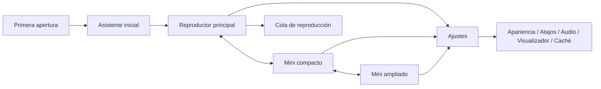
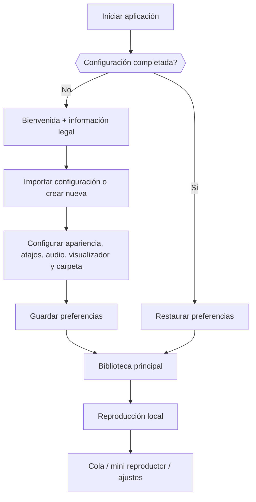
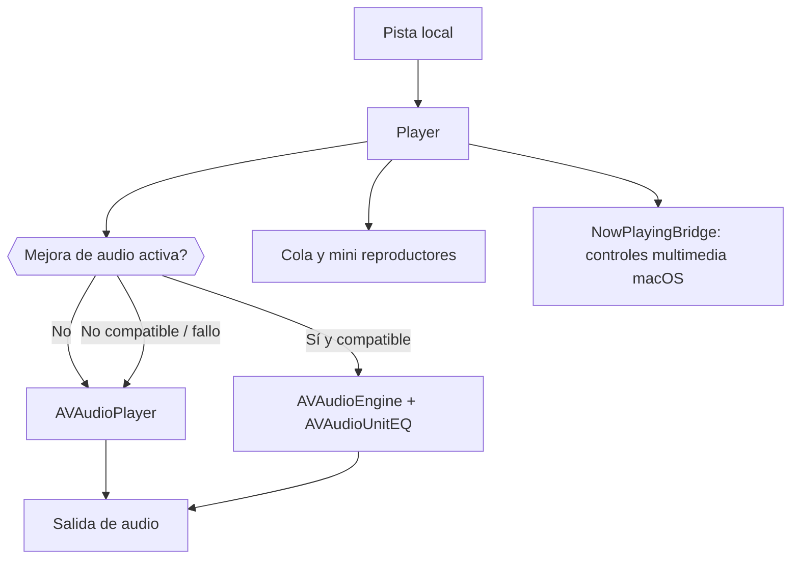

# Música Local · Versión 1.0

**Reproductor nativo de música local para macOS**  
**Desarrollo:** Andrés Báez · **Licencia:** MIT · **Distribución:** Gratuita · **Idioma:** Español

> Versión orientada a macOS 12 Monterey o posterior, con soporte de compilación para Intel x86_64 y Apple Silicon arm64. Probado funcionalmente por el usuario en MacBook Pro A1707 en versiones anteriores; **la variante de seguridad de Touch Bar incluida aquí requiere nueva validación en ese equipo**.

## Índice

1. [Descripción y funcionalidades](#descripción-y-funcionalidades)
2. [Compatibilidad y requisitos](#compatibilidad-y-requisitos)
3. [Instalación y compilación](#instalación-y-compilación)
4. [Flujo de uso](#flujo-de-uso)
5. [Arquitectura](#arquitectura)
6. [Preferencias y datos](#preferencias-y-datos)
7. [Touch Bar: seguridad y compatibilidad](#touch-bar-seguridad-y-compatibilidad)
8. [Pruebas recomendadas](#pruebas-recomendadas)
9. [Registro de compilación y resolución de errores](#registro-de-compilación-y-resolución-de-errores)
10. [Licencia y documentación](#licencia-y-documentación)

## Descripción y funcionalidades

Música Local reproduce una biblioteca de archivos locales con una interfaz SwiftUI y componentes AppKit. No requiere conexión a servicios de streaming.

| Área | Capacidades |
|---|---|
| Reproducción | Reproducir, pausar, avanzar, retroceder, buscar posición, volumen y silencio |
| Biblioteca | Selección de carpeta, metadatos, carátulas, actualización y caché |
| Cola | Orden automático, aleatorio, selección directa y resaltado de pista actual |
| Interfaz | Reproductor principal, mini compacto y mini ampliado |
| Apariencia | Tema del sistema, claro marfil y oscuro; fondo translúcido opcional |
| Acento | Color de carátula, escala de grises y color del sistema cuando no hay imagen |
| Audio | Motor original y `AVAudioEngine` experimental con perfiles de ecualización |
| Visualizador | Barras, curva, segmentos, puntos, montaña o desactivado; **amplitud, no FFT** |
| Preferencias | Asistente inicial, atajos, `settings.json` persistente |
| Ayuda | Ayuda integrada en español, acerca de y lector de documentos legales |
| Touch Bar | **Sin controles personalizados**, para evitar bloquear la barra táctil |

### Pantallas y navegación



## Compatibilidad y requisitos

| Requisito | Detalle |
|---|---|
| Sistema | macOS 12.0 o superior |
| Arquitectura | Intel `x86_64` o Apple Silicon `arm64` |
| Lenguaje | Swift; SwiftUI, AppKit, AVFoundation, MediaPlayer |
| Herramientas | `swiftc`, SDK de macOS, `sips`, `iconutil`, `plutil`, Bash |
| Xcode | No se necesita un proyecto `.xcodeproj`; sí es necesario tener herramientas/SDK compatibles |

En Terminal, verifica el compilador:

```bash
swiftc --version
xcode-select -p
```

## Instalación y compilación

1. Descomprime el proyecto.
2. Abre Terminal en la carpeta que contiene `build.sh`.
3. Ejecuta:

```bash
chmod +x build.sh
./build.sh
open MusicaLocal.app
```

`build.sh` descubre automáticamente todos los archivos `*.swift` en `src/`, enlaza una aplicación nativa, incorpora iconos y recursos, y conserva la versión anterior del `.app` si falla el proceso.

| Etapa | Progreso comunicado |
|---|---:|
| Preparación | 0 % |
| Detección del entorno | 10 % |
| Descubrimiento de fuentes | 20 % |
| Compilación y enlace | 30–85 % |
| Validación del paquete | 95 % |
| Publicación | 100 % |

> Los porcentajes son hitos del script, no tiempos estimados ni avances continuos.

## Flujo de uso



La configuración se edita posteriormente en **Música Local → Configuración**. La carpeta se administra en **Configuración → Caché**.

## Arquitectura

| Capa | Ruta | Propósito |
|---|---|---|
| Inicio | `MusicaLocal.swift` | `@main`, escenas y comandos |
| Modelos | `src/Models/` | Pistas, acento y estado |
| Reproducción | `src/Player/` | Control compartido de audio |
| Servicios | `src/Services/` | Caché, audio experimental, carátulas, preferencias, sistema multimedia |
| Ventanas | `src/Structure/` | Ventana principal y mini reproductor |
| Presentación | `src/Views/` | Biblioteca, visualizadores, reproductor y preferencias |
| Soporte | `src/Support/` | Idioma, temas, ayuda y panel Acerca de |
| Recursos | `assets/`, `resources/` | Icono e idioma español |

La **estructura completa, archivo por archivo, y diagramas de dependencias** se encuentran en [STRUCTURE.md](STRUCTURE.md).

### Flujo de audio



El audio experimental comienza desactivado. Los perfiles disponibles son **Original**, **Equilibrado**, **Graves** y **Voces**. Un archivo no admitido por ese motor debe seguir la ruta de respaldo; si falla un cambio de motor, desactiva mejoras desde Ajustes.

## Preferencias y datos

Ubicación predeterminada de datos de la aplicación:

```text
~/Library/Application Support/MusicaLocal/
├── Artworks/        # Carátulas locales procesadas
├── library.json     # Biblioteca y metadatos
└── settings.json    # Preferencias persistentes
```

| Clave en settings.json | Uso |
|---|---|
| `theme` | Claro, oscuro o sistema |
| `accentMode` | Acento de carátula o personalizado |
| `customAccentHex` | Solo relevante con color único |
| `translucent` | Fondo translúcido activado/desactivado |
| `visualizer` | Estilo seleccionado o `off` |
| `folderPath` | Ruta de biblioteca recordada |
| `cacheEnabled` | Persistencia de biblioteca |
| `audioEnabled`, `audioProfile` | Motor experimental y perfil |
| `shortcuts` | Atajos configurados |

Los ajustes se escriben de manera atómica; **borrar caché no está diseñado para borrar `settings.json`**. Antes de restablecer o cambiar carpetas importantes, conserva una copia de estos archivos.

## Touch Bar y el icono nativo de macOS

**Integración completamente administrada por el sistema (MacBook Pro A1707):**

- `build.sh` crea `Contents/Resources/AppIcon.icns` a partir de `assets/AppIcon.png` y declara explícitamente `CFBundleIconFile = AppIcon` en `Contents/Info.plist`.
- La categoría del paquete se declara `public.app-category.music` y se conserva el identificador estable `com.local.musicalocal`.
- **La aplicación no reemplaza `NSApp.applicationIconImage`, no crea `NSTouchBar` y no instala botones táctiles propios.** El icono se obtiene del paquete por las APIs nativas de macOS.
- `NowPlayingBridge` continúa publicando canción, artista, álbum, carátula y estado, y atendiendo comandos multimedia mediante `MPNowPlayingInfoCenter` y `MPRemoteCommandCenter`.

La **Touch Bar / Control Strip** decide si muestra el icono de la aplicación y en qué posición aparecen los controles. macOS no ofrece a este reproductor una API pública que garantice la aparición del icono en ese espacio sin crear una barra táctil propia. Esta versión **no intenta forzarlo**, para evitar el bloqueo observado previamente.

### Comprobar que el icono esté registrado

Después de compilar en el Mac:

```bash
/usr/libexec/PlistBuddy -c 'Print :CFBundleIconFile' MusicaLocal.app/Contents/Info.plist
ls -lh MusicaLocal.app/Contents/Resources/AppIcon.icns
open MusicaLocal.app
```

Debe aparecer `AppIcon.icns` en la primera comprobación. Si la Touch Bar conserva un icono antiguo, cierra la aplicación antes de reemplazar el paquete; el sistema puede mantener información previamente almacenada en caché. No reinicies ni modifiques procesos de la Touch Bar como requisito de esta actualización.

## Pruebas recomendadas

| Prueba | Resultado esperado |
|---|---|
| Inicio y primer uso | Asistente únicamente cuando corresponda |
| Biblioteca | Se carga y recuerda la carpeta |
| Reproducción | Reproducir, pausar, buscar y pasar de pista |
| Mini reproductores | Ambas vistas funcionan y restauran ventana principal |
| Visualizador | Cambia estilo sin afectar audio |
| Apariencia | Conserva tema, acento y translucidez tras reiniciar |
| Audio experimental | Se puede desactivar y volver al motor original |
| Touch Bar | No se bloquea al cambiar de ventana o aplicación |
| Menús y ayuda | Se muestran en español; documentos legales se leen dentro de la app |

Para comparar CPU y RAM, reproduce la misma canción en condiciones similares y toma varias mediciones del Monitor de Actividad; una cifra aislada no demuestra una mejora estable.

## Registro de compilación y resolución de errores

Los registros se guardan en `logs/build-history.log` y `logs/build-AAAAMMDD-HHMMSS-PID.log`. Si falla `swiftc`, el script mantiene intacta la aplicación compilada previamente.

| Síntoma | Comprobación |
|---|---|
| `extra argument in call` | Revisar `VStack`/`HStack` con demasiados hijos directos en SwiftUI Monterey; agrupar con `Group` |
| API solo disponible en macOS 13 | Usar alternativas compatibles con macOS 12 |
| El icono no aparece | Verificar `assets/AppIcon.png` y la compilación del paquete |
| Touch Bar congelada | Probar esta versión sin `NSTouchBar` personalizada; validar con otras apps |
| Configuración no se restaura | Revisar `settings.json` y permisos del directorio de datos |

## Licencia y documentación

El software es **gratuito y de código abierto** y se distribuye según [LICENSE.md](LICENSE.md) (MIT). La documentación adicional está disponible en [Términos y condiciones](TERMINOS_Y_CONDICIONES.md) y [Privacidad](PRIVACIDAD.md); desde «Acerca de» también pueden consultarse dentro de la aplicación.

**Autor:** Andrés Báez · **Versión pública:** 1.0 · **Idiomas:** español (estructura preparada para localizaciones futuras).
