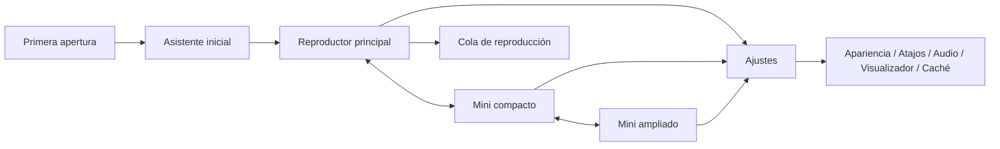
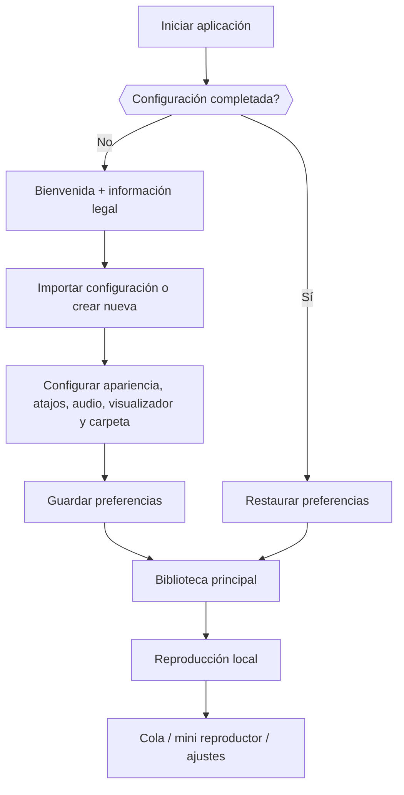
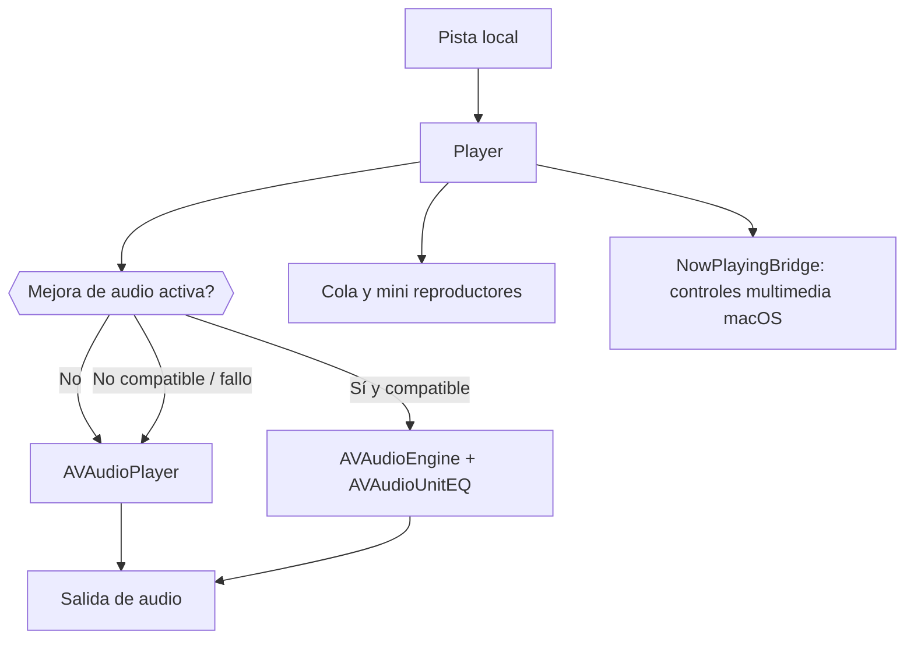

# Música Local · Versión 1.0.2

**Reproductor nativo de música local para macOS**  
**Desarrollo:** Andrés Báez · **Licencia:** MIT · **Distribución:** Gratuita · **Idioma:** Español

> Versión orientada a macOS 12 Monterey o posterior, con soporte de compilación para Intel x86_64 y Apple Silicon arm64. Probado funcionalmente por el usuario en MacBook Pro A1707 en versiones anteriores; **la variante de seguridad de Touch Bar incluida aquí requiere nueva validación en ese equipo**.

## Índice

1. [Descripción y funcionalidades](#descripción-y-funcionalidades)
2. [Compatibilidad y requisitos](#compatibilidad-y-requisitos)
3. [Instalación y compilación](#instalación-y-compilación)
4. [Flujo de uso](#flujo-de-uso)
5. [Arquitectura](#arquitectura)
6. [Preferencias y datos](#preferencias-y-datos)
7. [Touch Bar: seguridad y compatibilidad](#touch-bar-seguridad-y-compatibilidad)
8. [Pruebas recomendadas](#pruebas-recomendadas)
9. [Registro de compilación y resolución de errores](#registro-de-compilación-y-resolución-de-errores)
10. [Licencia y documentación](#licencia-y-documentación)

## Descripción y funcionalidades

Música Local reproduce una biblioteca de archivos locales con una interfaz SwiftUI y componentes AppKit. No requiere conexión a servicios de streaming.

| Área | Capacidades |
|---|---|
| Reproducción | Reproducir, pausar, avanzar, retroceder, buscar posición, volumen y silencio |
| Biblioteca | Selección de carpeta, metadatos, carátulas, actualización y caché |
| Cola | Orden automático, aleatorio, selección directa y resaltado de pista actual |
| Etiquetas | Identificación acústica bajo demanda y edición individual de MP3, FLAC y M4A compatibles |
| Letras | Vista de reproducción con carátula, letra y seguimiento por línea o palabra en el reproductor principal |
| Listas de reproducción | Creación con nombre, edición de canciones y reproducción desde la lista seleccionada |
| Interfaz | Reproductor principal, mini compacto y mini ampliado, con transiciones que respetan «Reducir movimiento» de macOS |
| Apariencia | Tema del sistema, claro marfil y oscuro; fondo translúcido opcional |
| Acento | Color de carátula, escala de grises y color del sistema cuando no hay imagen |
| Audio | Motor original y `AVAudioEngine` experimental con perfiles de ecualización |
| Visualizador | Barras, curva, segmentos, puntos, montaña o desactivado; **amplitud, no FFT** |
| Preferencias | Asistente inicial, atajos, `settings.json` persistente |
| Ayuda | Ayuda integrada en español, acerca de y lector de documentos legales |
| Touch Bar | **Sin controles personalizados**, para evitar bloquear la barra táctil |

### Pantallas y navegación



## Compatibilidad y requisitos

| Requisito | Detalle |
|---|---|
| Sistema | macOS 12.0 o superior |
| Arquitectura | Intel `x86_64` o Apple Silicon `arm64` |
| Lenguaje | Swift; SwiftUI, AppKit, AVFoundation, MediaPlayer |
| Herramientas | `swiftc`, SDK de macOS, `sips`, `iconutil`, `plutil`, Bash |
| Xcode | No se necesita un proyecto `.xcodeproj`; sí es necesario tener herramientas/SDK compatibles |

En Terminal, verifica el compilador:

```bash
swiftc --version
xcode-select -p
```

## Instalación y compilación

1. Descomprime el proyecto.
2. Abre Terminal en la carpeta que contiene `build.sh`.
3. Ejecuta:

```bash
chmod +x build.sh
./build.sh
open release/app/MusicaLocal.app
```

`build.sh` descubre automáticamente todos los archivos `*.swift` en `src/`, enlaza una aplicación nativa, incorpora iconos y recursos, y conserva la versión anterior del `.app` si falla el proceso.

| Etapa | Progreso comunicado |
|---|---:|
| Preparación | 0 % |
| Detección del entorno | 10 % |
| Descubrimiento de fuentes | 20 % |
| Compilación y enlace | 30–85 % |
| Validación del paquete | 95 % |
| Publicación | 100 % |

> Los porcentajes son hitos del script, no tiempos estimados ni avances continuos.

El build publica la aplicación en `release/app/MusicaLocal.app` y una copia comprimida en `release/zip/MusicaLocal V1.0.2.zip`. Cada compilación exitosa reemplaza ambas salidas.

Después de compilar, `./build-dmg.sh` genera `dist/MusicaLocal-1.0.2.dmg` para instalación manual.

### Actualizaciones

Música Local consulta la última publicación estable de su repositorio de GitHub al iniciar, después de completar el asistente inicial. El botón con flechas circulares, antes del nombre de la carpeta, muestra la versión actual y te permite buscar e instalar actualizaciones. También puedes usar **Música Local → Buscar actualizaciones…**. La consulta solicita los datos de la publicación a GitHub y la aplicación compara su versión con la instalada.

Si hay una versión más nueva, pulsa **Descargar e instalar**. La app verifica la huella SHA-256 publicada por GitHub, extrae el ZIP y valida el paquete antes de reemplazar la copia actual. Luego intenta reiniciarse. La carpeta donde está instalada debe permitir escritura.

Para publicar una actualización, fija `RELEASE_VERSION` en `build.sh` y usa una etiqueta equivalente, por ejemplo `v1.1.0`. Adjunta el ZIP generado a la publicación estable de GitHub. El actualizador también reconoce el nombre anterior `MusicaLocal-v1.0.zip`.

## Flujo de uso



La configuración se edita posteriormente en **Música Local → Configuración**. La carpeta se administra en **Configuración → Caché**.

### Letras sincronizadas

Reproduce una canción y pulsa **Letras**, junto a **Cola**, para abrir la vista con carátula y letra. La carátula se centra en su columna, con el título y el artista alineados debajo. El texto de la línea activa usa el color de acento por defecto. Puedes desplazarte para leer otras líneas y pulsar **Volver a la línea actual** para retomar el seguimiento. Haz clic en una línea sincronizada para saltar a su posición.

La app usa marcas por palabra o segmento cuando están presentes en un LRC extendido o en los bloques Lyricsfile compatibles que entrega LRCLIB. Con marcas LRC tradicionales el resaltado es por línea. Las letras sin marcas se muestran como texto. La nota musical señala el comienzo instrumental, las líneas instrumentales explícitas y los intervalos con final de línea explícito.

Usa **−** para mostrar la letra antes o **+** para mostrarla después, en pasos de **0,25 s**. El botón de restablecer devuelve el desfase a cero. El ajuste se guarda por canción en `settings.json` y conserva el archivo fuente. En **Configuración → Letras** puedes cambiar el seguimiento, las animaciones, el resaltado por palabra y la suspensión al desplazar manualmente. También puedes mostrar títulos y artistas largos con puntos suspensivos o desplazamiento automático, y desactivar el acento del texto activo. «Reducir movimiento» desactiva las animaciones y muestra los metadatos largos con puntos suspensivos.

Música Local busca primero un archivo `.lrc` junto a la pista, luego una copia descargada. Si necesita buscar en línea, envía a [LRCLIB](https://lrclib.net/docs) el título, el artista y, cuando están disponibles, el álbum y la duración. La búsqueda alternativa comprueba artista y duración antes de aceptar otras versiones. Las búsquedas sin resultados se conservan durante seis horas. **Volver a buscar** permite consultar de nuevo.

Para preparar toda la biblioteca, espera a que termine el escaneo y pulsa **Configuración → Caché → Sincronizar letras**. Puedes cancelar y continuar con el mismo botón. Las letras ya guardadas se reutilizan. El progreso indica cuántas pistas se revisaron, cuántas tienen letra y cuántas quedan pendientes o fallaron. El servicio realiza consultas secuenciales y respeta la espera indicada por LRCLIB.

Las descargas se guardan como datos JSON en archivos `.js` dentro de `~/Library/Application Support/MusicaLocal/Lyrics/`. Las copias anteriores con extensión `.json` se convierten al volver a usarlas. Borrar la caché de la biblioteca conserva las letras descargadas.

#### Verificar la sincronización

En macOS, ejecuta `bash tests/check-lyrics.sh` para comprobar marcas conocidas, letras sin tiempos, desfases, pausas musicales, caché y respuestas HTTP simuladas. Las pruebas usan un directorio temporal y un servicio simulado.

Para la comprobación visual en Monterey, usa una canción con un LRC local que tenga marcas conocidas por línea y otra con marcas por palabra. Pausa a mitad de palabra, reanuda, salta hacia adelante y atrás y cambia de canción varias veces. Repite con el motor original y el experimental. Desplaza la letra sin pulsar una línea y comprueba que solo se suspende el centrado. Vuelve a la línea actual, prueba ambos signos del desfase y reabre la app para verificar su persistencia. Alterna entre ambos mini reproductores y la ventana principal, minimiza la ventana y repite con «Reducir movimiento» activado.

### Actualizar metadatos de una canción

1. Haz clic derecho sobre una canción de la biblioteca y elige **Actualizar metadatos…**. La ventana muestra las etiquetas y la carátula actuales.
2. Pulsa **Identificar canción** para generar una huella local. AcoustID recibe la huella y la duración; MusicBrainz consulta las ediciones de la grabación que elijas. Introduce en el diálogo tu clave de usuario de AcoustID cuando corresponda. AcoustID la exige desde el 1 de enero de 2027. La clave de usuario se descarta al cerrar la ventana.
3. Compara título, artista, duración, puntuación devuelta por AcoustID e identificador de grabación. Elige una edición concreta para obtener álbum, artista del álbum, fecha, números de pista y disco y portada frontal. Puedes conservar los datos del álbum si la edición es incierta. Si la edición no tiene portada, se conserva la original.
4. Marca cada campo que quieras actualizar y corrige los valores propuestos si hace falta. También puedes introducir etiquetas manualmente sin hacer una búsqueda. Marca **Incrustar portada frontal** para guardar la portada propuesta dentro del audio.
5. Pulsa **Aplicar cambios**. Si la pista está abierta incluso en pausa, pulsa antes **Detener esta canción**. La cola y las listas conservan su orden y sus referencias. La aplicación volverá a cargar la pista cuando decidas reproducirla.

Se admiten FLAC nativos con comentarios Vorbis y bloques PICTURE, MP3 con ID3v2.3/2.4 compatible o sin ID3v2 y M4A autónomos no fragmentados con etiquetas de iTunes. Los archivos con estructuras incompatibles, enlaces o permisos insuficientes conservan su contenido. Para MP3 con ID3v2.3 se guarda el año de cuatro cifras. En M4A el formato de pista y disco es número o número/total.

La aplicación prepara el archivo en el mismo volumen, comprueba las etiquetas y verifica con SHA-256 que se conservaron los datos de audio. El respaldo queda en una carpeta oculta `.musicalocal-…` junto al archivo y **Mostrar copia de recuperación en Finder** abre su ubicación. Para restaurarlo manualmente, detén la pista y sustituye el archivo editado por esa copia, conservando la ruta y el nombre originales. Recarga la biblioteca si lo restauras fuera de la aplicación. Cada edición exitosa conserva una copia independiente hasta que decidas eliminarla.

#### Compilar con reconocimiento acústico

La edición local funciona con el build estándar. Para distribuir el reconocimiento, el mantenedor prepara Chromaprint **1.6.0** a partir del archivo fuente oficial enlazado abajo. Se necesita CMake solo en la máquina de compilación. El script verifica el SHA-256, usa vDSP de Accelerate y el remuestreador incluido en el código fuente de Chromaprint, y construye una biblioteca dinámica para la arquitectura del equipo con destino macOS 12. AVFoundation decodifica la pista en bloques. El usuario final no instala herramientas adicionales. [Código fuente de Chromaprint 1.6.0](https://github.com/acoustid/chromaprint/archive/refs/tags/v1.6.0.tar.gz)

```bash
scripts/build-chromaprint.sh "/ruta/chromaprint-1.6.0.tar.gz" "/ruta/Chromaprint preparado"
export MUSICALOCAL_CHROMAPRINT_DIR="/ruta/Chromaprint preparado"
# Configurar MUSICALOCAL_ACOUSTID_CLIENT con la clave de aplicación registrada del proyecto.
./build.sh
bash tests/check-metadata.sh
```

Registra la aplicación en AcoustID, configura la variable de entorno fuera del repositorio y expórtala antes del build. El empaquetado incorpora esa clave **de aplicación** en el Info.plist. Las claves **de usuario** son personales y se introducen en el diálogo. API gratuita para usos no comerciales según sus condiciones. [Documentación de AcoustID](https://acoustid.org/webservice)

El paquete incluye el binario dinámico, el archivo fuente verificado, los avisos de licencia y el script de compilación en `Contents/Resources/ThirdParty/Chromaprint` y `Contents/Frameworks`. Conserva esos recursos en el ZIP y DMG. El código de Música Local sigue bajo MIT. El binario de Chromaprint incluye código bajo LGPL 2.1 y puede sustituirse por una compilación compatible de la biblioteca. Genéralo por arquitectura y conserva el esquema de firma de la aplicación al redistribuirla. [Licencia de Chromaprint](https://github.com/acoustid/chromaprint/blob/v1.6.0/LICENSE.md)

`tests/check-metadata.sh` usa pistas sintéticas y respuestas simuladas. Con la variable `MUSICALOCAL_CHROMAPRINT_DIR`, mide también la huella real con un WAV sintético de dos minutos.

### Listas de reproducción

1. Abre **Listas** junto al nombre de la carpeta, pulsa **Nueva lista…** y escribe un nombre.
2. Vuelve a **Biblioteca** con el selector de listas. Haz clic secundario en una canción y elige **Añadir a una lista**.
3. Abre la lista con el selector. Para retirar una canción, haz clic secundario y elige **Quitar de esta lista**. Para retirar una canción que ya no está en la biblioteca, usa **Canciones fuera de la biblioteca**.

La selección determina qué canciones usa la reproducción automática. Las canciones añadidas manualmente a la cola conservan su prioridad.

## Arquitectura

| Capa | Ruta | Propósito |
|---|---|---|
| Inicio | `MusicaLocal.swift` | `@main`, escenas y comandos |
| Modelos | `src/Models/` | Pistas, acento y estado |
| Reproducción | `src/Player/` | Control compartido de audio |
| Servicios | `src/Services/` | Caché, audio experimental, carátulas, preferencias, sistema multimedia |
| Ventanas | `src/Structure/` | Ventana principal y mini reproductor |
| Presentación | `src/Views/` | Biblioteca, visualizadores, reproductor y preferencias |
| Soporte | `src/Support/` | Idioma, temas, ayuda y panel Acerca de |
| Recursos | `assets/`, `resources/` | Icono e idioma español |

La **estructura completa, archivo por archivo, y diagramas de dependencias** se encuentran en [STRUCTURE.md](STRUCTURE.md).

### Flujo de audio



El audio experimental comienza desactivado. En **Configuración → Audio** puedes elegir **Original**, **Equilibrado**, **Graves**, **Voces**, **Rock**, **Pop**, **Jazz**, **Clásica** o **Electrónica**. El perfil se aplica al instante si el motor experimental está activo. Si el motor no admite un archivo, la aplicación usa la salida original.

## Preferencias y datos

Ubicación predeterminada de datos de la aplicación:

```text
~/Library/Application Support/MusicaLocal/
├── Artworks/        # Carátulas locales procesadas
├── library.json     # Biblioteca y metadatos
├── Playlist/        # Un archivo Nombre de la lista.js por lista
└── settings.json    # Preferencias persistentes
```

| Clave en settings.json | Uso |
|---|---|
| `theme` | Claro, oscuro o sistema |
| `accentMode` | Acento de carátula o personalizado |
| `customAccentHex` | Solo relevante con color único |
| `translucent` | Fondo translúcido activado/desactivado |
| `visualizer` | Estilo seleccionado o `off` |
| `folderPath` | Ruta de biblioteca recordada |
| `cacheEnabled` | Persistencia de biblioteca |
| `audioEnabled`, `audioProfile` | Motor experimental y perfil |
| `shortcuts` | Atajos configurados |

Los ajustes se escriben de manera atómica; **borrar caché no está diseñado para borrar `settings.json`**. Antes de restablecer o cambiar carpetas importantes, conserva una copia de estos archivos.

Los archivos `.js` de las listas contienen datos JSON con el nombre y las rutas de las canciones en orden. Se guardan al crear o editar una lista y se conservan al limpiar la caché.

## Touch Bar y el icono nativo de macOS

**Integración completamente administrada por el sistema (MacBook Pro A1707):**

- `build.sh` crea `Contents/Resources/AppIcon.icns` a partir de `assets/AppIcon.png` y declara explícitamente `CFBundleIconFile = AppIcon` en `Contents/Info.plist`.
- La categoría del paquete se declara `public.app-category.music` y se conserva el identificador estable `com.local.musicalocal`.
- **La aplicación no reemplaza `NSApp.applicationIconImage`, no crea `NSTouchBar` y no instala botones táctiles propios.** El icono se obtiene del paquete por las APIs nativas de macOS.
- `NowPlayingBridge` continúa publicando canción, artista, álbum, carátula y estado, y atendiendo comandos multimedia mediante `MPNowPlayingInfoCenter` y `MPRemoteCommandCenter`.

La **Touch Bar / Control Strip** decide si muestra el icono de la aplicación y en qué posición aparecen los controles. macOS no ofrece a este reproductor una API pública que garantice la aparición del icono en ese espacio sin crear una barra táctil propia. Esta versión **no intenta forzarlo**, para evitar el bloqueo observado previamente.

### Comprobar que el icono esté registrado

Después de compilar en el Mac:

```bash
/usr/libexec/PlistBuddy -c 'Print :CFBundleIconFile' release/app/MusicaLocal.app/Contents/Info.plist
ls -lh release/app/MusicaLocal.app/Contents/Resources/AppIcon.icns
open release/app/MusicaLocal.app
```

Debe aparecer `AppIcon.icns` en la primera comprobación. Si la Touch Bar conserva un icono antiguo, cierra la aplicación antes de reemplazar el paquete; el sistema puede mantener información previamente almacenada en caché. No reinicies ni modifiques procesos de la Touch Bar como requisito de esta actualización.

## Pruebas recomendadas

| Prueba | Resultado esperado |
|---|---|
| Inicio y primer uso | Asistente únicamente cuando corresponda |
| Biblioteca | Se carga y recuerda la carpeta |
| Reproducción | Reproducir, pausar, buscar y pasar de pista |
| Mini reproductores | Ambas vistas funcionan y restauran ventana principal |
| Visualizador | Cambia estilo sin afectar audio |
| Apariencia | Conserva tema, acento y translucidez tras reiniciar |
| Audio experimental | Se puede desactivar y volver al motor original |
| Touch Bar | No se bloquea al cambiar de ventana o aplicación |
| Menús y ayuda | Se muestran en español; documentos legales se leen dentro de la app |

Para comparar CPU y RAM, reproduce la misma canción en condiciones similares y toma varias mediciones del Monitor de Actividad; una cifra aislada no demuestra una mejora estable.

## Registro de compilación y resolución de errores

Los registros se guardan en `logs/build-history.log` y `logs/build-AAAAMMDD-HHMMSS-PID.log`. Si falla `swiftc`, el script mantiene intacta la aplicación compilada previamente.

| Síntoma | Comprobación |
|---|---|
| `extra argument in call` | Revisar `VStack`/`HStack` con demasiados hijos directos en SwiftUI Monterey; agrupar con `Group` |
| API solo disponible en macOS 13 | Usar alternativas compatibles con macOS 12 |
| El icono no aparece | Verificar `assets/AppIcon.png` y la compilación del paquete |
| Touch Bar congelada | Probar esta versión sin `NSTouchBar` personalizada; validar con otras apps |
| Configuración no se restaura | Revisar `settings.json` y permisos del directorio de datos |

## Licencia y documentación

El software es **gratuito y de código abierto** y se distribuye según [LICENSE.md](LICENSE.md) (MIT). La documentación adicional está disponible en [Términos y condiciones](TERMINOS_Y_CONDICIONES.md) y [Privacidad](PRIVACIDAD.md); desde «Acerca de» también pueden consultarse dentro de la aplicación.

**Autor:** Andrés Báez · **Versión pública:** 1.0.2 · **Idiomas:** español (estructura preparada para localizaciones futuras).
