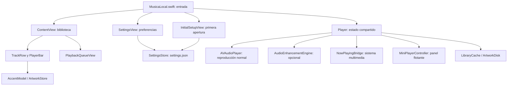
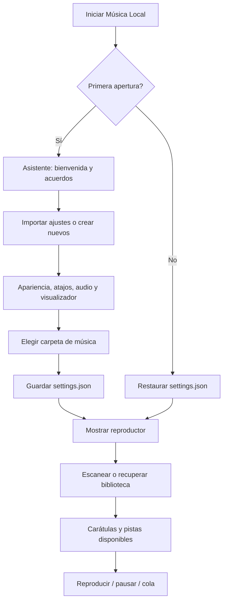
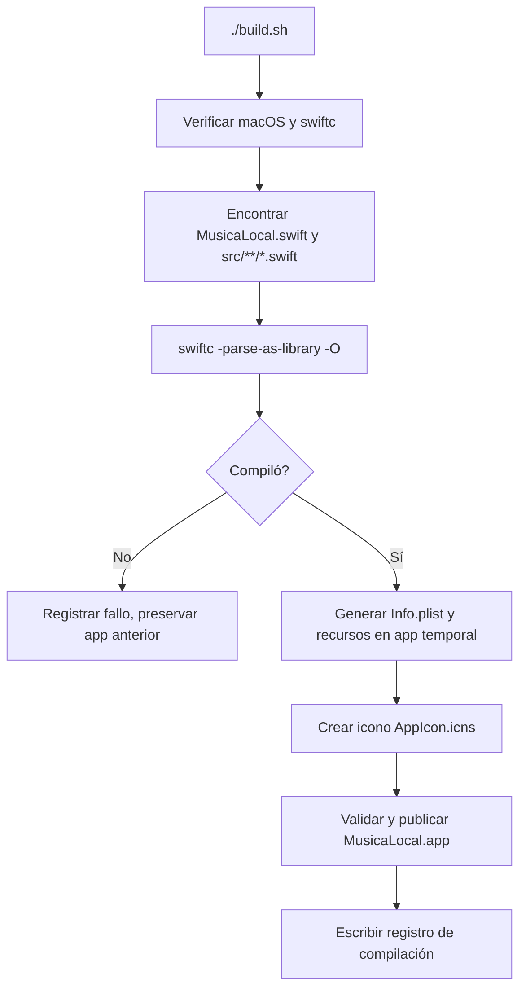

# STRUCTURE — Música Local 1.0

> Inventario de los archivos incluidos en esta entrega, generado a partir del árbol real. Compatibilidad objetivo: macOS 12+; implementación nativa SwiftUI / AppKit / AVFoundation.

## 1. Árbol de directorios

```text
MusicaLocal_1.0/
├── assets/
│   └── AppIcon.png
├── resources/
│   └── es.lproj/
│       ├── InfoPlist.strings
│       └── Localizable.strings
├── src/
│   ├── Models/
│   │   ├── AccentModel.swift
│   │   ├── ColumnLayout.swift
│   │   ├── PlaybackModels.swift
│   │   └── Track.swift
│   ├── Player/
│   │   └── Player.swift
│   ├── Services/
│   │   ├── ArtworkDisk.swift
│   │   ├── ArtworkStore.swift
│   │   ├── AudioEnhancementEngine.swift
│   │   ├── FilenameParser.swift
│   │   ├── LibraryCache.swift
│   │   ├── NowPlayingBridge.swift
│   │   ├── PlaylistStore.swift
│   │   ├── SettingsStore.swift
│   │   ├── ShortcutManager.swift
│   │   └── UpdateChecker.swift
│   ├── Structure/
│   │   ├── MiniPlayerController.swift
│   │   └── WindowChrome.swift
│   ├── Support/
│   │   ├── AboutMusicaLocal.swift
│   │   ├── Colors.swift
│   │   ├── Formatting.swift
│   │   ├── HelpMusicaLocal.swift
│   │   ├── SpanishMenuLocalization.swift
│   │   ├── Theme.swift
│   │   └── WindowUtilities.swift
│   └── Views/
│       ├── Components/
│       │   ├── AccentViews.swift
│       │   ├── ArtworkView.swift
│       │   ├── AudioLevelVisualizer.swift
│       │   └── PlaybackQueueView.swift
│       ├── Main/
│       │   ├── ColumnHeader.swift
│       │   ├── ContentView.swift
│       │   ├── HeaderBar.swift
│       │   ├── PlayerBar.swift
│       │   └── TrackRow.swift
│       ├── MiniPlayer/
│       │   ├── MiniPlayerView.swift
│       │   └── MiniProgress.swift
│       └── Settings/
│           ├── InitialSetupView.swift
│           └── SettingsView.swift
├── .gitignore
├── build.sh
├── LICENSE.md
├── MusicaLocal.swift
├── PRIVACIDAD.md
├── README.md
└── TERMINOS_Y_CONDICIONES.md
```

Al compilar se crean **`logs/`**, **`release/.app/MusicaLocal.app`** y **`release/.zip/MusicaLocal-v1.0.zip`** como salidas locales del build.

## 2. Responsabilidad de los módulos

| Ruta | Función |
|---|---|
| `src/Models/AccentModel.swift` | Selección cromática según carátula y respaldo del sistema |
| `src/Models/ColumnLayout.swift` | Disposición de columnas en la biblioteca |
| `src/Models/PlaybackModels.swift` | Estado de reproducción, reloj y modos |
| `src/Models/Track.swift` | Representación de las pistas y sus metadatos |
| `src/Player/Player.swift` | Reproducción, navegación, cola y coordinación de motores |
| `src/Services/ArtworkDisk.swift` | Miniaturas y persistencia de carátulas |
| `src/Services/ArtworkStore.swift` | Carga de carátulas en memoria |
| `src/Services/AudioEnhancementEngine.swift` | AVAudioEngine y perfiles experimentales de ecualización |
| `src/Services/FilenameParser.swift` | Extracción de datos desde nombres de archivos |
| `src/Services/LibraryCache.swift` | Cache de biblioteca y directorio de datos |
| `src/Services/NowPlayingBridge.swift` | Integración de información multimedia y comandos remotos macOS |
| `src/Services/PlaylistStore.swift` | Guarda y recupera las listas de reproducción como archivos `.js` con datos JSON |
| `src/Services/SettingsStore.swift` | Lectura y guardado de settings.json |
| `src/Services/ShortcutManager.swift` | Atajos configurables |
| `src/Services/UpdateChecker.swift` | Consulta de la última publicación estable en GitHub y comparación con la versión del paquete |
| `src/Structure/MiniPlayerController.swift` | Gestión del NSPanel compacto y ampliado |
| `src/Structure/WindowChrome.swift` | Comportamiento y semáforos de ventanas |
| `src/Support/AboutMusicaLocal.swift` | Ventana Acerca de y lector de documentos legales |
| `src/Support/Colors.swift` | Paleta y colores de interfaz |
| `src/Support/Formatting.swift` | Funciones de formateo |
| `src/Support/HelpMusicaLocal.swift` | Ayuda integrada en español |
| `src/Support/SpanishMenuLocalization.swift` | Localización del menú de macOS |
| `src/Support/Theme.swift` | Temas y apariencia |
| `src/Support/WindowUtilities.swift` | Funciones auxiliares de ventana |
| `src/Views/Components/AccentViews.swift` | Fondos con materiales y acento |
| `src/Views/Components/ArtworkView.swift` | Representación de carátulas |
| `src/Views/Components/AudioLevelVisualizer.swift` | Visualizador de amplitud con cinco estilos |
| `src/Views/Components/PlaybackQueueView.swift` | Cola actual e interacción |
| `src/Views/Main/ColumnHeader.swift` | Cabeceras de columnas |
| `src/Views/Main/ContentView.swift` | Vista de biblioteca y reproductor principal |
| `src/Views/Main/HeaderBar.swift` | Cabecera principal |
| `src/Views/Main/PlayerBar.swift` | Controles, volumen, progreso y visualizador |
| `src/Views/Main/TrackRow.swift` | Fila de canción y resaltado activo |
| `src/Views/MiniPlayer/MiniPlayerView.swift` | Interfaz mini compacta y ampliada |
| `src/Views/MiniPlayer/MiniProgress.swift` | Progreso del mini reproductor |
| `src/Views/Settings/InitialSetupView.swift` | Asistente de configuración inicial |
| `src/Views/Settings/SettingsView.swift` | Preferencias de aspecto, audio, visualizador, caché y atajos |

## 3. Relación entre subsistemas



**Touch Bar:** no existen controles `NSTouchBar` personalizados ni asignaciones manuales de `NSApp.applicationIconImage`. El icono nativo se obtiene de `AppIcon.icns` declarado en `Info.plist`. macOS conserva la gestión de su Touch Bar, Control Strip y controles multimedia; `NowPlayingBridge` publica los metadatos de reproducción. La aparición y posición del icono quedan bajo control del sistema.

## 4. Flujo de usuario y persistencia



La biblioteca y las preferencias se almacenan habitualmente en:

```text
~/Library/Application Support/MusicaLocal/
├── Artworks/
├── library.json
├── Playlist/
└── settings.json
```

`settings.json` guarda tema, modo de acento, hexadecimal si es un color personalizado, transparencia, visualizador, carpeta, estado de la caché, audio y atajos. Las carátulas y metadatos se guardan por separado.

## 5. Flujo de compilación



El script construye en un directorio temporal y solo reemplaza la aplicación anterior al completar las verificaciones. Los porcentajes indican etapas, no progreso continuo del compilador.

## 6. Convenciones de mantenimiento

- **Añadir vistas:** colocarlas en `src/Views/` según su responsabilidad; evitar `VStack` con más de diez hijos directos por compatibilidad SwiftUI en Monterey.
- **Añadir servicios:** usar `src/Services/`; no crear un segundo reproductor si se puede reutilizar `Player`.
- **Cambiar persistencia:** actualizar `SettingsStore` y, cuando corresponda, el asistente inicial, manteniendo compatibilidad con `settings.json` anterior.
- **Cambiar empaquetado:** actualizar `build.sh` y verificar `Info.plist`, recursos españoles y documentos legales.
- **Touch Bar:** no reinstalar `window.touchBar`, `NSTouchBarDelegate` ni controles personalizados sin pruebas específicas en hardware A1707.
- **Pruebas:** compilar en macOS 12 Intel, verificar audio, mini ventanas, arranque, atajos, ajustes y el comportamiento de la Touch Bar al cambiar de aplicación.

## 7. Documentación relacionada

- [`README.md`](README.md): instalación, funcionalidades y operación.
- [`LICENSE.md`](LICENSE.md), [`TERMINOS_Y_CONDICIONES.md`](TERMINOS_Y_CONDICIONES.md), [`PRIVACIDAD.md`](PRIVACIDAD.md): documentos legales.

## Registro nativo del icono (v1.0)

`build.sh` genera `AppIcon.icns` y lo declara con `CFBundleIconFile`, junto con `LSApplicationCategoryType = public.app-category.music`. El código de inicio no modifica el icono con AppKit. Esto evita personalizar la Touch Bar y delega su interfaz al sistema.
